<!-- Profile README for Ronak Singh (Pragylucky). Visuals live in assets/; regenerate with: python3 assets/src/build.py -->


  

&nbsp;&nbsp;&nbsp;

  

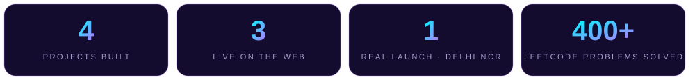

  

I'm an **Electrical Engineering student** who builds products end to end. 
I find the problem, decide what *not* to build, ship it, and learn from what people actually do.

 

<picture>
  <source media="(prefers-color-scheme: dark)" srcset="assets/title-think-dark.svg"/>
  
</picture>

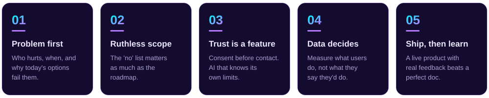

  

<picture>
  <source media="(prefers-color-scheme: dark)" srcset="assets/title-work-dark.svg"/>
  
</picture>

### 🐾 PupMeow &nbsp;·&nbsp; the neighbourhood app for pet families in Delhi NCR

&nbsp;

 

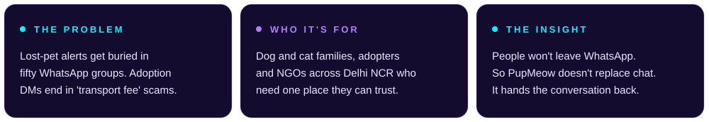

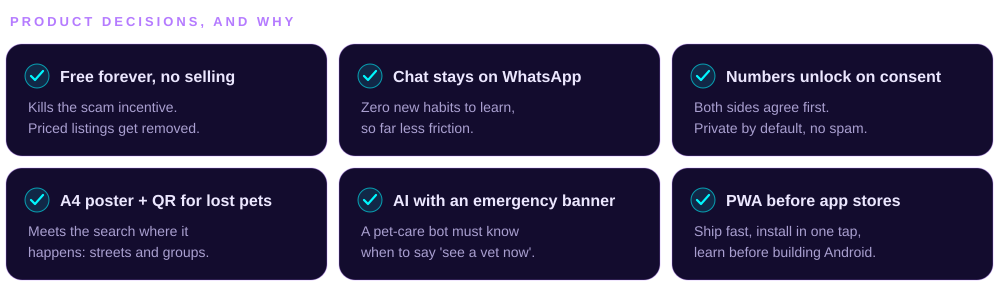

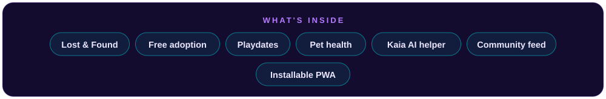

**[Live site](https://pupmeow.in)** &nbsp;·&nbsp; **[Get the app](https://pupmeow.in/get-app)** &nbsp;·&nbsp; **[Source](https://github.com/Pragylucky/PupMeow)** &nbsp;·&nbsp; Next up: Android app and a vets &amp; groomers directory

 

<a href="https://fin-sight-ai-six-kappa.vercel.app">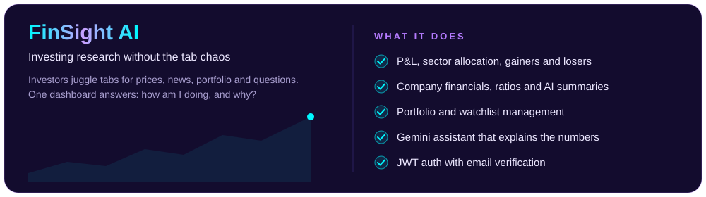</a>

**[Live demo](https://fin-sight-ai-six-kappa.vercel.app)** &nbsp;·&nbsp; **[Source](https://github.com/Pragylucky/FinSightAi)** &nbsp;·&nbsp; Next up: real-time market data

 

<a href="https://github.com/Pragylucky/Autonomous-kinematics-simulator">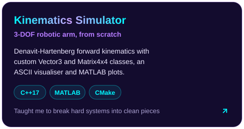</a>&nbsp;<a href="https://pragylucky.github.io/Movie-SITE/">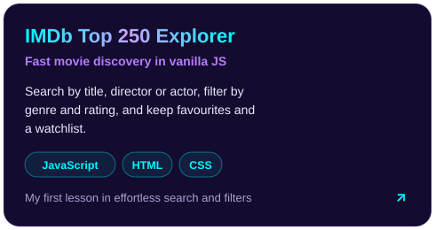</a>

 

<picture>
  <source media="(prefers-color-scheme: dark)" srcset="assets/title-toolkit-dark.svg"/>
  
</picture>

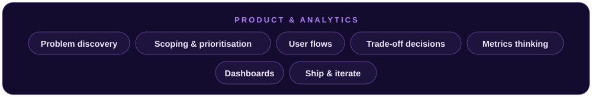

 

 

<picture>
  <source media="(prefers-color-scheme: dark)" srcset="assets/title-activity-dark.svg"/>
  
</picture>

&nbsp;

<picture>
  <source media="(prefers-color-scheme: dark)" srcset="https://raw.githubusercontent.com/Pragylucky/Pragylucky/output/github-snake-dark.svg"/>
  
</picture>

 

<picture>
  <source media="(prefers-color-scheme: dark)" srcset="assets/title-now-dark.svg"/>
  
</picture>

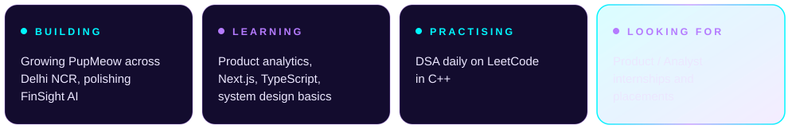

  

<a href="mailto:ronaksingh18062005@gmail.com"></a>
