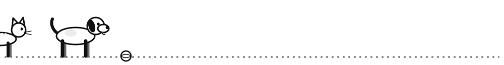

<!-- ============================================================= -->
<!--  Profile README for Ronak Singh (Pragylucky)                  -->
<!--  Animated art (light + dark): python3 assets/src/build.py    -->
<!-- ============================================================= -->

<div align="center">

<picture>
  <source media="(prefers-color-scheme: dark)" srcset="assets/header-dark.svg"/>
  
</picture>

<br/>

<a href="https://www.linkedin.com/in/ronak-singh-79234328a/"></a>
<a href="https://leetcode.com/u/Pragy_lucky/"></a>
<a href="mailto:ronaksingh18062005@gmail.com"></a>


</div>

---

##  Hey, I'm Ronak

I'm an **Electrical Engineering student** who fell for software. I like building things end to end: a clean UI, a solid API, and some intelligence in the middle. My engineering background means I enjoy the maths-heavy, systems-level side of things just as much as shipping web apps.

```text
🎓  B.Tech, Electrical Engineering
⚛️  Building full-stack apps with the MERN stack
🐾  Founder of PupMeow, live at pupmeow.in for Delhi NCR pet families
🧠  Integrating AI (Gemini) and live financial data into real products
🧮  Solving DSA problems on LeetCode in C++
🦾  Writing robotics / kinematics simulators from scratch
🎯  Looking for PRODUCT/ANALYST internships and placements
```

---

##  Featured Projects

###  Flagship: PupMeow  

<div align="center">

<a href="https://pupmeow.in"></a>
<a href="https://www.instagram.com/pupmeow.in"></a>

**The neighbourhood app for dog and cat families in Delhi NCR**

<picture>
  <source media="(prefers-color-scheme: dark)" srcset="assets/pupmeow-walk-dark.svg"/>
  
</picture>

<a href="https://pupmeow.in"></a>

<picture>
  <source media="(prefers-color-scheme: dark)" srcset="assets/paws-dark.svg"/>
  
</picture>

</div>

When a pet goes missing in Delhi, the alert gets buried across fifty WhatsApp groups, and adoption in Instagram DMs often turns into a "transport fee" scam. PupMeow puts the pet, the owner and the neighbourhood in one place, and keeps conversations on WhatsApp where people already talk. **Free forever, and no buying or selling of animals.**

| | |
|---|---|
| 🚨 **Lost & Found** | Report in a minute, print an A4 poster with QR, share a ready-made WhatsApp image, and let neighbours tap "I saw him / her" |
| 💛 **Free adoption** | Listings from families and NGOs with age, vaccine and sterilisation filters; priced listings get removed |
| 🤝 **Playdates** | Request and accept; the number unlocks only after both sides agree |
| 💉 **Pet health** | Vaccines, deworming, vet visits and weight chart, with Google Calendar or .ics reminders |
| 🤖 **Kaia, the AI helper** | Pet-care chat with an emergency banner for anything that sounds urgent |
| 📣 **Feed & community** | Photos, hashtags, follows, comments and search |
| 📱 **PWA** | Installable, dark mode, offline page |


🌐 [**Live at pupmeow.in**](https://pupmeow.in) &nbsp;•&nbsp; 📲 [**Get the app**](https://pupmeow.in/get-app) &nbsp;•&nbsp; 💻 [**Source**](https://github.com/Pragylucky/PupMeow)

---

### More projects

<table>
<tr>
<td width="50%" valign="top">

###  FinSight AI
**AI-powered financial intelligence platform**

Research stocks, track a portfolio, build watchlists, read market news and ask an AI assistant, all from one dashboard.

- 📊 Dashboard with P&L, sector allocation, gainers and losers
- 🏢 Company analysis: financials, ratios, charts, AI summary
- 💼 Portfolio and watchlist management
- 🤖 Gemini-powered financial assistant
- 🔐 JWT auth with email verification


[🌐 **Live Demo**](https://fin-sight-ai-six-kappa.vercel.app) • [💻 **Source**](https://github.com/Pragylucky/FinSightAi)

</td>
<td width="50%" valign="top">

###  Autonomous Kinematics Simulator
**3-DOF robotic arm, built from scratch**

Forward kinematics for an RRR manipulator using the Denavit-Hartenberg convention, with no robotics libraries.

- 🧮 Custom `Vector3` and `Matrix4x4` classes
- 🕹️ Interactive CLI simulator with ASCII visualizer
- 📐 Homogeneous transformation matrices
- 📊 MATLAB visualization and demo mode
- 🏗️ Clean OOP architecture, CMake build


[💻 **Source**](https://github.com/Pragylucky/Autonomous-kinematics-simulator)

</td>
</tr>
<tr>
<td colspan="2" valign="top">

###  IMDb Top 250 Movie Explorer
**Fast, responsive movie discovery in vanilla JS** &nbsp;·&nbsp; search by title, director or actor &nbsp;·&nbsp; genre and rating filters &nbsp;·&nbsp; details modal &nbsp;·&nbsp; favorites and watchlist in Local Storage


[🌐 **Live Demo**](https://pragylucky.github.io/Movie-SITE/) • [💻 **Source**](https://github.com/Pragylucky/Movie-SITE)

</td>
</tr>
</table>

---

##  Tech Stack

<div align="center">

| | |
|---|---|
| **Languages** |  |
| **Frontend** |  |
| **Backend & DB** |  |
| **Tools & Deploy** |  |

</div>

---

##  GitHub Stats

<div align="center">

<picture>
  <source media="(prefers-color-scheme: dark)" srcset="https://streak-stats.demolab.com/?user=Pragylucky&theme=dark&hide_border=true&background=0D1117"/>
  
</picture>
<picture>
  <source media="(prefers-color-scheme: dark)" srcset="https://leetcard.jacoblin.cool/Pragy_lucky?theme=dark&font=Karma&border=0&radius=6"/>
  
</picture>

<picture>
  <source media="(prefers-color-scheme: dark)" srcset="https://leetcard.jacoblin.cool/Pragy_lucky?theme=dark&font=Karma&ext=heatmap"/>
  
</picture>

</div>

###  Contribution snake

<div align="center">
<picture>
  <source media="(prefers-color-scheme: dark)" srcset="https://raw.githubusercontent.com/Pragylucky/Pragylucky/output/github-snake-dark.svg"/>
  <source media="(prefers-color-scheme: light)" srcset="https://raw.githubusercontent.com/Pragylucky/Pragylucky/output/github-snake.svg"/>
  
</picture>
</div>

---

##  What I'm Working On

| | |
|---|---|
| 🔭 **Now** | Growing PupMeow in Delhi NCR (Android app next), polishing FinSight AI, building my portfolio site |
| 🌱 **Learning** | Next.js, TypeScript, Postgres and system design basics |
| 🧠 **Practicing** | DSA daily on [LeetCode](https://leetcode.com/u/Pragy_lucky/) |
| 🎯 **Next** | Vets and groomers in PupMeow, inverse kinematics for the arm, real-time data in FinSight |
| 💬 **Ask me about** | Next.js and Supabase, MERN, C++, kinematics, building with AI APIs |

---

##  Let's Connect

I'm open to **internships, placements and collaborations**. If you've got something interesting in web, AI or robotics, reach out.

<div align="center">

📧 [ronaksingh18062005@gmail.com](mailto:ronaksingh18062005@gmail.com) &nbsp;•&nbsp; 💼 [LinkedIn](https://www.linkedin.com/in/ronak-singh-79234328a/) &nbsp;•&nbsp; 🧩 [LeetCode](https://leetcode.com/u/Pragy_lucky/)

<br/><br/>

<a href="mailto:ronaksingh18062005@gmail.com">
<picture>
  <source media="(prefers-color-scheme: dark)" srcset="assets/footer-dark.svg"/>
  
</picture>
</a>

</div>
